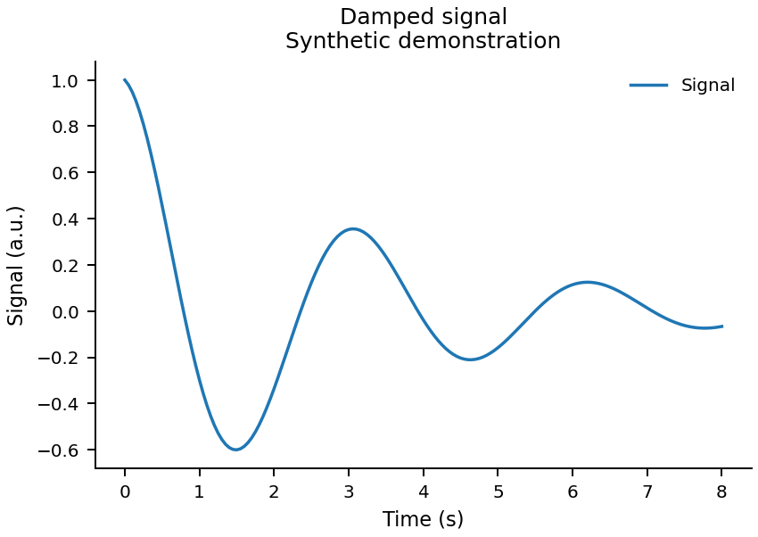
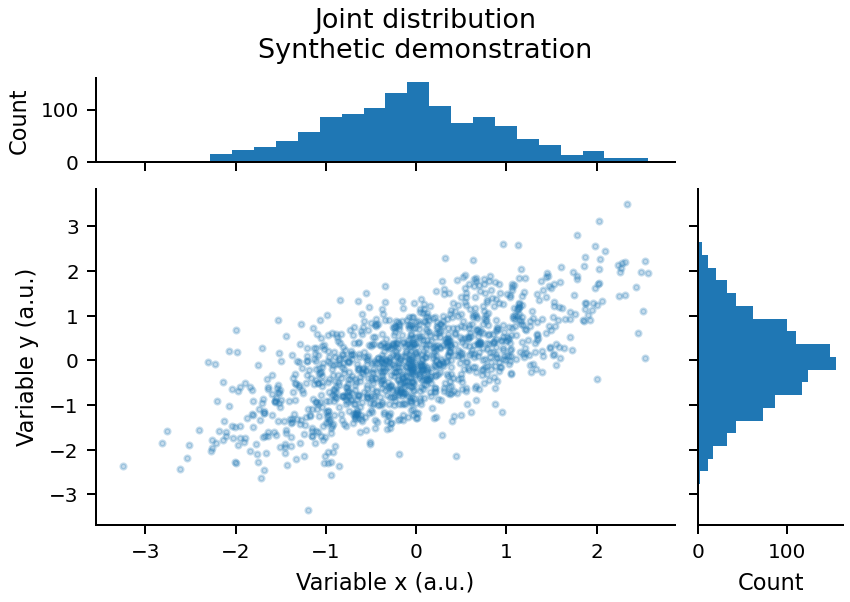
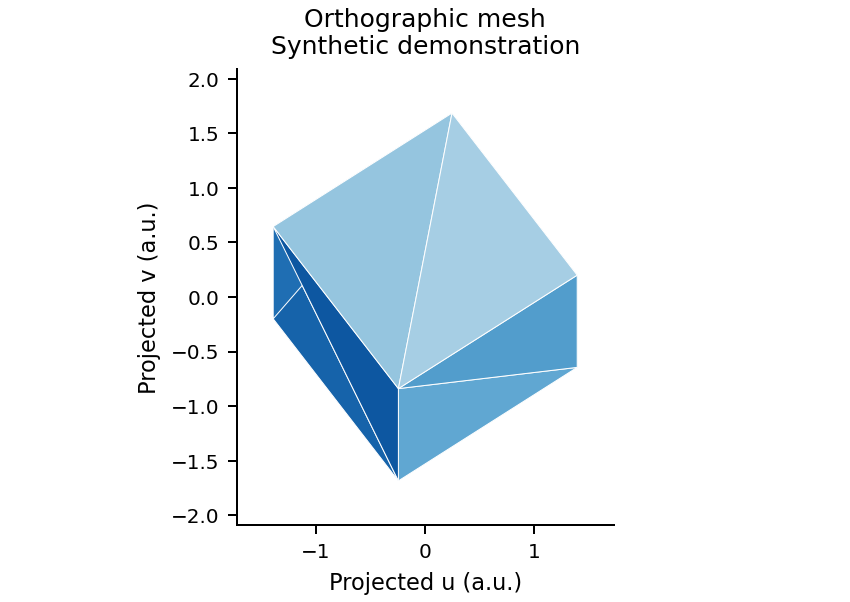
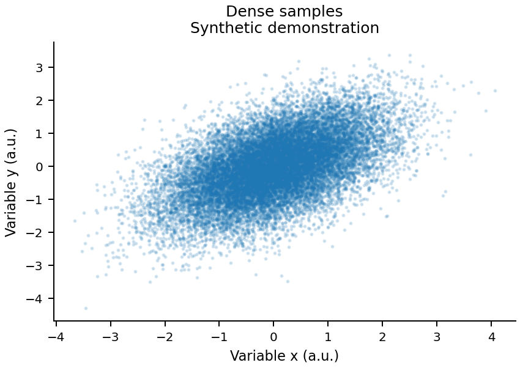

# Scientific Visualization

**面向 AI 编程助手的科研绘图 Skill。**

用自然语言描述绘图任务，让 Agent 根据数据含义选择图型、生成可复现的 Python/Matplotlib 代码、调整布局与样式，并检查实际导出的图件。

适用于科研折线图、散点图、多面板布局、三维网格投影，以及 PDF / SVG / PNG 导出。目前已在 **Codex** 中验证技能发现和安装后运行。

[快速开始](#快速开始) · [使用示例](#使用示例) · [直接运行代码](#直接运行代码) · [验证范围](#验证范围) · [来源与许可](#来源与许可)

## 示例效果

下图由仓库中的示例代码生成，**全部使用明确标注的合成数据**。

| 折线图 | 散点与边际分布 |
|---|---|
|  |  |

| 三维网格投影 | 密集散点与混合导出 |
|---|---|
|  |  |

## 它能做什么

- **生成科研图**：检查数据结构、变量含义与单位，选择合适的图型和坐标尺度。
- **修改现有绘图**：调整字体、配色、线型、图例、标注与面板间距。
- **组织多面板**：处理共享轴、边际分布、面板比例和对齐。
- **绘制三维几何**：使用正交投影、三角网格和面深度排序展示空间结构。
- **导出论文图件**：按物理尺寸输出 PDF、SVG 和 PNG，按需仅栅格化密集数据层。
- **检查生成结果**：区分语法、执行和目视检查状态，记录环境、输入来源与导出结果。

技能使用渐进披露：入口保留工作流和路由，具体任务只加载相关参考。当前包含 **11 份参考文档、25 条知识记录、4 个可运行示例**。

## 快速开始

### 1. 获取仓库

```bash
git clone https://github.com/Panda-dda/Scientific-Visualization.git
cd Scientific-Visualization
```

### 2. 安装到 Codex

将整个技能目录复制到用户级位置：

```text
~/.agents/skills/scientific-visualization/
```

下面的命令在仓库根目录执行，使用 Python 完成跨平台复制。目标目录已经存在时会报错，不会覆盖已有安装。

```bash
python -c "from pathlib import Path; import shutil; shutil.copytree(Path.cwd(), Path.home()/'.agents'/'skills'/'scientific-visualization', ignore=shutil.ignore_patterns('.git', '.venv', '__pycache__', 'outputs', '.env', '.env.*'))"
```

安装后，目标目录下应能直接找到 `SKILL.md`。如果只在一个项目使用，也可复制到该项目的 `.agents/skills/scientific-visualization/`；通常选择一种安装范围即可。

Codex 中可显式输入 `$scientific-visualization`。若新技能没有出现在列表中，可重新加载或重启 Codex。发现机制参考 [Codex 官方技能文档](https://learn.chatgpt.com/docs/build-skills)。

### 3. 发出绘图请求

```text
$scientific-visualization

读取 data.csv，t 列表示时间，单位秒；x1～x5 表示五组位移，单位米。
绘制五条曲线，保持颜色含义一致，避免图例遮挡数据。
画布宽 120 mm、高 85 mm，导出 PDF、SVG 和 PNG 到 figures/。
请实际执行代码、检查图像并修正排版问题。
```

第一次使用也可以直接请求合成演示：

```text
$scientific-visualization

使用明确标记的合成数据，生成折线图、边际分布图和三维网格图。
保存到 demo-figures/，并检查生成结果。
```

运行绘图代码需要 Python、NumPy 和 Matplotlib。建议使用已有环境；如需新建环境：

```bash
python -m venv .venv
# 激活环境：Windows PowerShell 使用 .venv\Scripts\Activate.ps1
# macOS / Linux 使用 source .venv/bin/activate
python -m pip install numpy matplotlib
```

这里安装的是当前可用版本；本项目实际验证过的版本见下方“验证范围”。运行核心示例不需要原教程仓库、联网、外部字体或 LaTeX。

## 使用示例

### 改进已有图件

```text
$scientific-visualization

检查 plot_results.py 和现有输出，改进字体、配色、图例与布局。
保留数据处理逻辑和物理含义，另存新版图件。
请说明具体修改，并检查最终输出。
```

### 绘制多面板图

```text
$scientific-visualization

使用 results.csv 生成两列面板：
左侧显示状态曲线，右侧显示文件中已计算的误差量。
先确认每列的定义和单位，再统一字体、颜色与时间范围。
输出 180 mm 宽的 PDF 和 PNG。
```

### 只审查，不修改

```text
$scientific-visualization

只审查这张图的可读性和数据表达，指出具体位置的问题。
重点检查坐标尺度、单位、图例遮挡和配色。
先不要修改代码或数据。
```

### 已有 MATLAB 代码

```text
$scientific-visualization

保留 MATLAB，检查现有绘图代码的标签、配色与布局。
不要转换成 Python；未明确的变量含义先从项目材料核实。
```

本仓库的可运行实现以 Python/Matplotlib 为主。其他技术栈可参考通用设计原则，但没有相应的现成实现与运行验证。

## 直接运行代码

不使用 Agent，也可以在仓库根目录运行四个示例：

```bash
python examples/line_scatter.py --demo --output-dir outputs/line
python examples/marginal_panels.py --demo --seed 7 --output-dir outputs/marginals
python examples/projected_mesh.py --demo --output-dir outputs/mesh
python examples/mixed_export.py --demo --output-dir outputs/export
```

读取自己的 CSV：

```bash
python examples/line_scatter.py --input data.csv --x-column t --y-column value --xlabel "Time (s)" --ylabel "Displacement (m)" --output-dir outputs/my-data
```

`data.csv` 需要包含与参数对应的列名。数据应为有限数值；空值或无效单元格会报出行号和列名。

| 参数 | 用途 |
|---|---|
| `--input` / `--demo` | 选择文件输入或合成演示，两者互斥 |
| `--synthetic-input` | 将外部合成数据文件明确标为演示数据 |
| `--output-dir` | 指定独立输出目录 |
| `--formats pdf svg png` | 选择导出格式 |
| `--width-mm` / `--height-mm` | 指定物理画布尺寸 |
| `--dpi` | 设置 PNG 和矢量文件内栅格层的分辨率 |
| `--font-size` / `--line-width` | 覆盖默认样式 |
| `--overwrite` | 明确允许覆盖目标输出 |
| `--help` | 查看每个示例的完整参数 |

三维网格输入使用 NPZ，包含 `vertices: (N, 3)` 和从零开始的整数索引 `faces: (M, 3)`；`--unit` 指定输入坐标单位。

每次运行默认输出图件及 `run.json`，其中记录输入来源、文件哈希、参数、依赖版本、参考 ID 和导出状态。目视检查状态初始为 `not_performed`，需要实际查看图像后再填写观察结果。输入失败时不会自动换成演示数据；重复使用输出目录时默认拒绝覆盖。

## 项目结构

```text
Scientific-Visualization/
├── SKILL.md                 # 技能入口、工作流和参考路由
├── references/              # 11 份按需参考
├── examples/                # 4 个示例及共享输入/导出逻辑
├── assets/styles/           # 可覆盖的 Matplotlib 样式
├── docs/
│   ├── images/              # 合成示例预览
│   └── validation.md        # 已测环境、结果和边界
├── SOURCE_MAP.md            # 知识 ID、原始出处和改编记录
└── LICENSES/                # 来源署名与许可文本
```

参考主题包括图型选择、字体、配色、标注、二维尺度、三维投影、多面板、导出、调试及可选动画。每条知识保留适用条件、输入要求、参数、常见错误与来源位置。

## 验证范围

截至 2026-11-06，已在以下环境验证：

| 项目 | 已验证内容 |
|---|---|
| 环境 | Windows · Python 3.12.7 · NumPy 1.26.4 · Matplotlib 3.9.2 |
| 技能格式 | `SKILL.md` 格式校验、Codex 0.154.0 发现及安装后运行 |
| 行为检查 | 44 项检查通过，涵盖输入校验、尺度边界、投影、覆盖保护等 |
| 运行独立性 | 四个示例从隔离副本、其他工作目录运行 |
| 图件检查 | 6 份 PDF 经 Poppler 渲染与目视检查，核对物理尺寸和字体嵌入 |
| 其他格式 | PNG 像素尺寸检查；SVG 的 XML、文字及混合图层结构检查 |

完整口径见 [验证说明](docs/validation.md)。这些结果对应上述环境，不代表所有平台、依赖版本或图型均已验证。

当前边界：

- 三维面排序采用画家算法，不保证任意相交或透明面的遮挡正确。
- 共识与编队示例的合成数据仅用于绘图验证，不能作为真实实验或控制器性能证据。
- 特征根稳定性、统计推断及误差定义需要任务本身提供依据。
- 中文字体回退、LaTeX、Lab 配色分支和 MP4 编码尚未完成专项验收。
- 自动选用技能保留默认启用，但尚未完成独立端到端自动选择验证。
- 样式默认值可调整；目标期刊的尺寸、字体和格式要求应优先明确。

## 贡献与维护

欢迎提交绘图问题、最小可复现数据或改进建议。报告问题时，请附上运行命令、Python/Matplotlib 版本、预期行为与实际输出。

新增方法或示例时，请：

1. 明确输入数据的含义、单位和适用范围。
2. 保留来源与许可，更新 `SOURCE_MAP.md`。
3. 将合成数据与真实结果区分开。
4. 检查代码执行和实际图像，分别记录结果。
5. 修改共享样式或导出逻辑后，重新检查受影响的示例。

## 来源与许可

本项目参考 **Nicolas P. Rougier** 的 [《Scientific Visualization: Python + Matplotlib》](https://github.com/rougier/scientific-visualization-book)，将其中相关方法整理为中文任务参考、Agent 工作流和参数化绘图示例，并增加输入校验、输出保护与运行记录。

来源基线：`62fa569f30333c817c13e4dc757877c1192fd15a`。逐条出处、源文件声明和改编说明见 [SOURCE_MAP.md](SOURCE_MAP.md)。本项目为独立整理与适配项目，未声称获得原作者官方背书。

- 文档与基于书稿的提炼内容遵循 **CC BY-NC-SA 4.0**；保留署名、非商业及相同方式共享条件。
- 示例代码按对应来源声明处理，保留适用的 **BSD 2-Clause** 等许可；不能将整个仓库统一视为 BSD 或 MIT。
- 样式、参考片段及例外声明详见 [NOTICE](LICENSES/NOTICE.md) 和 [许可证目录](LICENSES/)。
- 发布内容不包含原书 PDF、字体包、原始模型资产或原书预生成图件；首页预览由本项目示例生成。

感谢原作者提供系统的科学可视化教材与示例。
